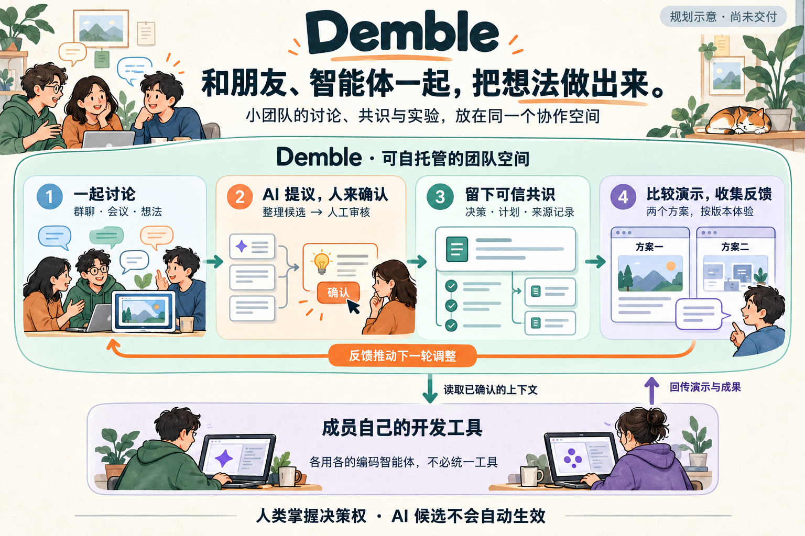
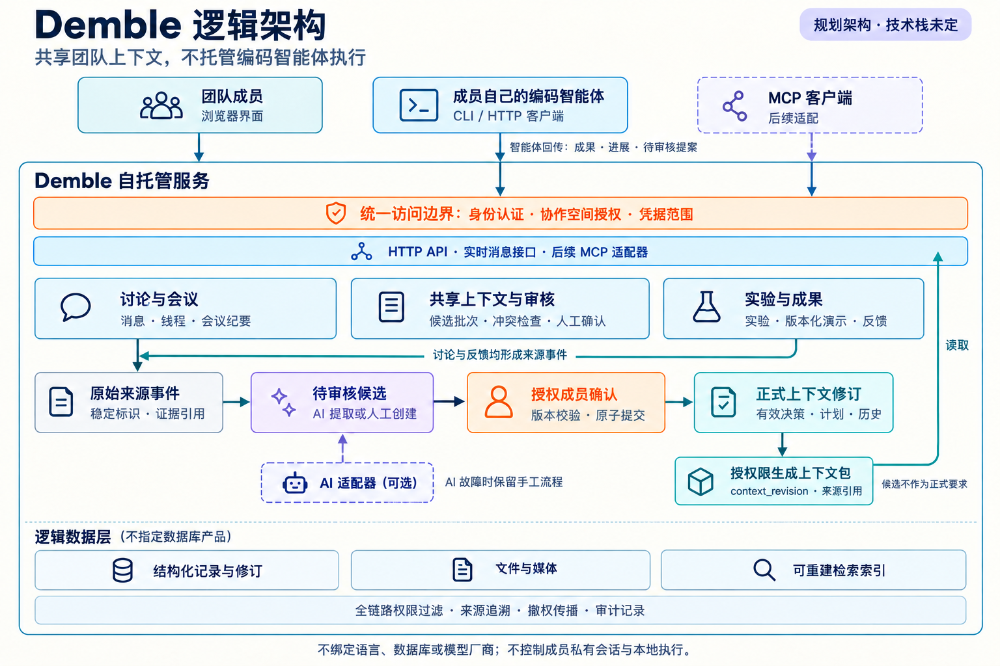

# Demble

**和朋友、AI 一起，把想法做出来。**

Demble 想给 2–10 人的小团队一个共同做项目的地方：在这里聊天、开会、记录决定，分享能实际体验的 Demo。

每个人仍然可以用自己熟悉的 Codex、Claude Code、OpenCode 等 AI 编程工具。Demble 帮大家记住项目背景、已经确定的事和接下来要做的事，省去在聊天记录和不同工具之间反复复制、解释的麻烦。

> **项目还在设计和原型验证阶段，目前没有可安装版本或公开 Demo。** 下面介绍的是我们准备做的功能。

[开发计划](docs/ROADMAP.md) · [产品需求](docs/PRD-v0.5.md) · [开工前先看这里](docs/CONTEXT_BASELINE.md) · [参与开发](CONTRIBUTING.md)

## 用起来会是什么样？

假设三个朋友准备做一个新项目，但还没确定方向。

大家先在一个项目空间里讨论、开会。AI 帮忙整理可能的结论和待办，成员可以一起检查、修改、确认。**AI 整理出来的内容不会自动变成团队决定。**

接着，两个人分别用各自的编程工具做出不同的 Demo，放回项目空间让大家体验。反馈会记在对应版本上，方便比较两个方案，而不是靠印象争论。

团队选定方向后，决定和计划随之更新。下一次有人继续开发，或换了一个编程工具，都能读到最新的项目背景，也能查到当时为什么这样决定。

## 开发者可以先看这张图

图里最重要的是三件事：

- **权限一致。** 网页上看不到的内容，也不能通过搜索、AI 或接口读到。
- **建议和决定分开。** 原始记录、待审核的建议、已确认的内容分别保存。改动已有决定时，要检查版本，保留修改记录。
- **开发工具各自运行。** Demble 提供项目背景、接收进展和成果，不接管成员的本地编程工具或私有会话。

这是一张规划图，不是部署方案；图里的方框也不表示要拆成独立服务。数据和接口的细节见[产品需求](docs/PRD-v0.5.md)，还没决定的问题见[开工说明](docs/CONTEXT_BASELINE.md)。

## 准备先做什么？

1. **S0：先让三个人用起来。** 能加入项目空间、聊天、引用消息，开一次语音和屏幕共享会议。
2. **S1：把讨论变成有依据的决定。** AI 整理建议，成员审核后保存，旧决定被替换时仍能查到原因。
3. **S2：拿两个 Demo 比一比。** 分享不同方案，按版本收集反馈，再调整计划。
4. **S3：接上不同的 AI 编程工具。** 让两种工具都能读取经过授权的项目背景，并提交成果。
5. **S4：连续使用后再改进。** 看看摘要、搜索和审核是不是真的省时间，再处理日常使用中的问题。

这些阶段都还没完成，详见[开发计划](docs/ROADMAP.md)。技术栈和具体工期尚未确定。

## 开发时坚持的几件事

方向、权限和正式决定由成员掌握。AI 平时在后台整理信息，被邀请时再参与讨论，不把每条闲聊都变成任务。

团队可以自己部署 Demble。日常聊天和会议不应强制依赖另一个协作平台的账号；成员也不必统一编辑器或 AI 编程工具。

当前文档和团队沟通以中文为主。欢迎带着真实问题、设计建议或小原型参与，开始前请读[贡献指南](CONTRIBUTING.md)和[团队约定](GOVERNANCE.md)。安全漏洞请[私密报告](SECURITY.md)。

## 怎么使用这份源码？

项目采用 **PolyForm Perimeter 1.0.1**。在遵守许可证的前提下，个人和企业内部可以使用；利用它向他人提供竞争产品或服务不在授权范围内，即使免费提供也可能受限。

这属于“源码可用”，并非 OSI 定义的开源软件。具体条款见 [LICENSE](LICENSE)，也可以先读[中文说明](docs/LICENSE.zh-CN.md)。
